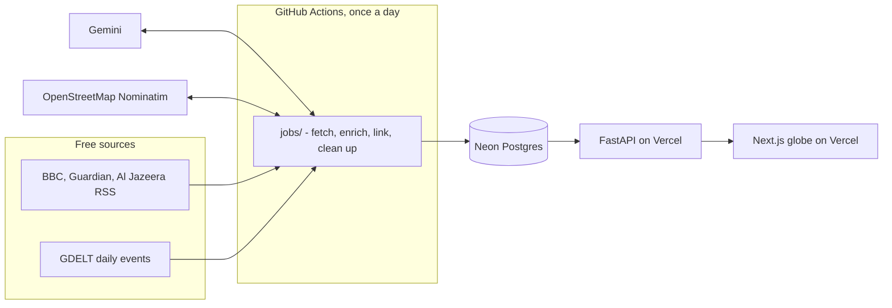

# Eye of Horus

In Egyptian myth, the Eye of Horus watched over the world. This project is an interactive 3D
globe of what is happening in the world today: politics, conflict, the economy, technology,
health, and society, each story placed where it happens.

The stories come from three world-news desks (BBC News, The Guardian, and Al Jazeera) and from
The GDELT Project's daily record of conflict events. Selecting a story opens a briefing with
its summary, place, and a link to the original article. Gemini proposes connections between
stories, such as two outlets reporting the same event, so readers can follow a story across
sources without leaving the map.

It started as a StormHacks 2026 project and now runs entirely on free tiers.

## Features

- **Live globe.** A spinning Earth with country shapes, elevation relief, an animated ocean,
  and a real star backdrop. Stories are grouped into clusters until you zoom in.
- **Layers.** Five groups of toggles: Conflict & Security, Politics & World, Economy & Tech,
  Humanitarian & Health, and Culture & Lifestyle. Filters for significance, time range, and
  country narrow what is shown.
- **Headlines and Explore.** A ranked tour of the day's top stories, or free exploration of
  everything the filters allow.
- **Linked stories.** Each connection Gemini proposes comes with a written explanation and its
  evidence. Links are hypotheses, never presented as verified causes.

## How it works



1. **Fetch.** Each morning the [daily workflow](.github/workflows/daily-ingest.yml) reads the
   three RSS feeds and yesterday's GDELT events file.
2. **Enrich.** Gemini writes a summary for each news story, picks its category and place, and
   rates its significance. OpenStreetMap turns the place into coordinates. GDELT events already
   have coordinates; their headlines come from the linked article page.
3. **Link.** Gemini compares each new story with related stories from the last three days and
   stores the connections it can support with evidence.
4. **Clean up.** Data older than 90 days is removed.
5. **Serve.** FastAPI reads events and links from Postgres. A story or link that doesn't match
   the shared schema is left out and the rest are shown; the live site never shows sample
   stories. If the database can't be reached, the site shows an error.
6. **Display.** The website only ever calls `/api` on its own origin; that route forwards to
   FastAPI from the server, so no database URL or API key reaches the browser.

See [`jobs/README.md`](jobs/README.md) for each job and [`apps/api/README.md`](apps/api/README.md)
for the API contract.

## Tech stack

| Layer | Tools |
| --- | --- |
| Website | Next.js 16 (App Router), React 19, TypeScript, `react-globe.gl` and Three.js |
| API | FastAPI on Python 3.12+, reached through a same-origin Next.js `/api` proxy |
| Database | Neon (serverless Postgres), accessed with `psycopg` 3 |
| AI | Google Gemini (`gemini-3.5-flash-lite`) to summarize, categorize, place, and link stories |
| Jobs | Python, scheduled with GitHub Actions |
| Hosting | Vercel (two projects: website and API) |
| Tests | Node's built-in test runner for the website; Python `unittest` and FastAPI `TestClient` for the API and jobs |

## Data sources

| Source | What it provides | Access |
| --- | --- | --- |
| [BBC News – World](https://www.bbc.co.uk/news/world) | World headlines and summaries | Official RSS feed, free |
| [The Guardian – World](https://www.theguardian.com/world) | World headlines and summaries | Official RSS feed, free |
| [Al Jazeera](https://www.aljazeera.com/) | World headlines and summaries | Official RSS feed, free |
| [The GDELT Project](https://www.gdeltproject.org/) | Coded conflict, protest, and crime events with coordinates | Free daily events file |
| [OpenStreetMap Nominatim](https://nominatim.org/) | Coordinates for the places stories name | Free, 1 request a second, ODbL |

Only headlines, short summaries, and links are stored and shown; every card links to the
original article.

## Run it locally

You need Node.js 20.9+, Python 3.12+, and Git.

```bash
git clone https://github.com/jackhtsong/news-observer.git
cd news-observer
cp .env.example .env
```

With `DATABASE_URL` left empty, everything runs on the bundled sample stories.

**API** (port 43124):

```bash
cd apps/api
python -m venv .venv
source .venv/bin/activate  # Windows: .venv\Scripts\activate
pip install -r requirements.txt
uvicorn main:app --reload --host 127.0.0.1 --port 43124
```

**Website** (second terminal, port 3000):

```bash
cd apps/web
npm ci
cp .env.example .env.local
npm run dev
```

Open http://localhost:3000. For the website alone, set `DATA_MODE=fixture` in
`apps/web/.env.local`. Never put `DATABASE_URL` or an API key in the website's env file.

**Tests:**

```bash
cd apps/api && python -m unittest discover -s tests -v
```

```bash
cd apps/web && npm test
```

The job tests are listed in [`jobs/README.md`](jobs/README.md#tests). GitHub Actions runs all of
them on every push. Run `git diff --check` before you commit.

## Deploy

Everything below fits the free plans of Neon, Vercel (Hobby), GitHub Actions, and Gemini. The
expected cost is $0 a month for a personal site's traffic.

1. **Database.** Create a Neon project and copy its connection string. Locally, put it in
   `.env` as `DATABASE_URL` and run `python -m jobs.ingest.apply_schema` once (the daily job
   also runs it).
2. **Gemini key.** Create one at https://aistudio.google.com/apikey.
3. **GitHub secrets.** In the repository's Settings → Secrets and variables → Actions, add
   `NEON_CONNECTION_STRING` (the Neon URL) and `GEMINI_API` (the Gemini key); the workflow
   passes them to the jobs as `DATABASE_URL` and `GOOGLE_API_KEY`. Start the first run from the Actions tab
   (**Daily ingest → Run workflow**); after that it runs every day at 06:15 UTC.
4. **API on Vercel.** Import the repository as a new project with the Root Directory left at
   the repository root. Vercel finds the FastAPI app through `pyproject.toml` and `server.py`.
   Add the `DATABASE_URL` environment variable.
5. **Website on Vercel.** Import the repository again as a second project with Root Directory
   `apps/web`. Add `DATA_MODE=api` and `API_BASE_URL=https://<your-api-project>.vercel.app`.
6. **Your domain.** Either add a subdomain (for example `globe.example.com`) in the website
   project's Domains settings, or serve it at a path of your portfolio (`example.com/globe`):
   set `BASE_PATH=/globe` in the website project, redeploy, and add these rewrites to the
   portfolio project's `vercel.json` (replace the host with the website project's URL):

   ```json
   {
     "rewrites": [
       { "source": "/globe", "destination": "https://news-observer.vercel.app/globe" },
       { "source": "/globe/:path*", "destination": "https://news-observer.vercel.app/globe/:path*" }
     ]
   }
   ```

After a quiet spell, the first visitor waits a few seconds while Neon and the API function
wake up.

## Credits

These are the third-party data and assets the site shows. The same list appears as small
credits in the bottom-right corner of the globe, in
`apps/web/src/components/data-attribution.tsx`. Keep the two in sync.

- **News:** [BBC News](https://www.bbc.co.uk/news/world), [The Guardian](https://www.theguardian.com/world),
  and [Al Jazeera](https://www.aljazeera.com/), through their public RSS feeds. Each story card
  links to the original article.
- **Conflict events:** [The GDELT Project](https://www.gdeltproject.org/), which monitors news outlets
  worldwide. Each GDELT story links to one article about the event, and its card names that
  article's outlet (for example "NEWS.WJCT.ORG VIA GDELT").
- **Geocoding:** © [OpenStreetMap](https://www.openstreetmap.org/copyright) contributors, via
  Nominatim (ODbL).
- **Star backdrop:** Yale Bright Star Catalogue, 5th Revised Ed. (Hoffleit, D. & Warren Jr., W. H. 1991),
  distributed by the CDS, Strasbourg, as catalog [V/50](https://cdsarc.cds.unistra.fr/viz-bin/cat/V/50).
  `apps/web/scripts/build-star-catalog.mjs` copies the positions, magnitudes, and B−V colors
  unchanged into `apps/web/src/data/bright-stars.json`. This project uses data obtained from the
  CDS, Strasbourg, France. Star colors follow Mitchell Charity's blackbody color table ("What
  color is a blackbody?", vendian.org). See [apps/web/docs/vector-globe.md](apps/web/docs/vector-globe.md#starry-backdrop).
- **Country shapes:** [Natural Earth](https://www.naturalearthdata.com/) Admin 0 countries,
  1:110m, public domain. See [apps/web/docs/vector-globe.md](apps/web/docs/vector-globe.md).
- **Country colors:** averaged from NASA Earth Observatory's [Blue Marble](https://visibleearth.nasa.gov/images/57752)
  (public domain); see [apps/web/README.md](apps/web/README.md).
- **Elevation relief:** `earth-topology.png` from the [three-globe](https://github.com/vasturiano/three-globe)
  examples (MIT, © Vasco Asturiano). Its original source is not stated upstream. See
  [apps/web/public/textures/README.md](apps/web/public/textures/README.md).
- **Ocean:** [Rare UI Fluid Orb](https://rareui.com/components/fluidorb), © 2026 Swami Malode;
  see [the license](apps/web/docs/licenses/rare-ui-LICENSE.txt).
- **Rendering:** [three.js](https://threejs.org/), [three-globe](https://github.com/vasturiano/three-globe),
  and [react-globe.gl](https://github.com/vasturiano/react-globe.gl), all MIT.
