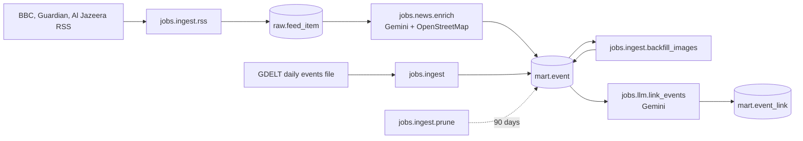

# Data jobs

Python jobs that fill the database. The API only reads it. In production, the
[daily workflow](../.github/workflows/daily-ingest.yml) runs these steps once a day with the
repository secrets `NEON_CONNECTION_STRING` and `GEMINI_API`, which it passes to the jobs as
`DATABASE_URL` and `GOOGLE_API_KEY` (the names used locally in `.env`).



Run everything from the repository root with the API's virtual environment active:

```bash
pip install -r apps/api/requirements.txt -r jobs/ingest/requirements.txt -r jobs/llm/requirements.txt
```

| Step | Command | What it does |
| --- | --- | --- |
| Schema | `python -m jobs.ingest.apply_schema` | Applies the migrations in `sql/` in order. Safe to re-run. |
| News feeds | `python -m jobs.ingest.rss` | Registers the outlets in [`news/sources.py`](news/sources.py), fetches their feeds, and stores up to 40 new items per outlet as `pending`. Options: `--dry-run`, `--force`, `--hours`, `--cap`. |
| Enrich news | `python -m jobs.news.enrich` | Sends pending items to Gemini in batches of 12 for a summary, category, place, keywords, and significance; geocodes the place with OpenStreetMap Nominatim (1 request per second). Stories with no single place are rejected. Needs `GOOGLE_API_KEY`. |
| Conflict events | `python -m jobs.ingest` | Loads yesterday's GDELT conflict events ([`ingest/gdelt.py`](ingest/gdelt.py)); falls back to `data/backup_csvs/finalconflictCSV.csv` if GDELT is unreachable. Loads ACLED too when its credentials are set. |
| Thumbnails | `python -m jobs.ingest.backfill_images` | Reads each article page's `og:image` for events without one. |
| Links | `python -m jobs.llm.link_events` | Asks Gemini whether new stories relate to others from the last 3 days. Each story is processed once (`mart.event.linked_at`), compared with at most 6 candidates, and a run stops after 250 calls (`--max-calls`). `--dry-run` only counts candidates. |
| Cleanup | `python -m jobs.ingest.prune --days 90` | Deletes events, links, and raw rows older than 90 days, keeping Neon's free 0.5 GB far from full. `--dry-run` only counts. |

To preview a day of GDELT rows without a database: `python -m jobs.ingest.gdelt --day 20261005`.

## Changing the news outlets

Edit `OUTLETS` in [`news/sources.py`](news/sources.py). Each needs a public RSS feed URL, a
short `source` id (stored in `mart.event.source`), and a display name in
`apps/web/src/lib/sources.ts`. The next `jobs.ingest.rss` run registers new outlets and pauses
removed ones. Update the credits in the README and `apps/web/src/components/data-attribution.tsx`.

## Gemini usage

A typical day is about 100 news items (about 9 enrichment calls) plus at most 250 linking
calls, within the Gemini free tier's daily allowance for `gemini-3.5-flash-lite`. If a call
fails on quota, the step stops and the unfinished items wait for the next run.

## Tests

No network or database:

```bash
python -m unittest discover -s jobs/ingest/tests -t . -v
python -m unittest discover -s jobs/news/tests -t . -v
python -m unittest discover -s jobs/llm/tests -t . -v
```

## Older databases

`sql/009_drop_hazards.sql` removes the retired natural-hazard tables and rows from a database
created before they were dropped. It deletes data, so `apply_schema` does not run it; apply it
by hand with `psql "$DATABASE_URL" -f sql/009_drop_hazards.sql` only where that is intended.
